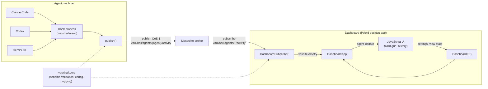
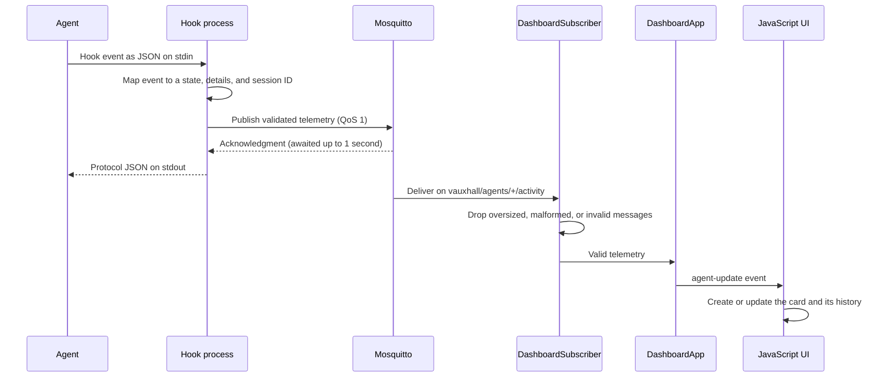

# Vauxhall Development Guide

This file is for contributors and coding agents working on Vauxhall: the
architecture, the dashboard's behavior and implementation, and the rules for
developing and releasing it. User documentation lives in [README.md](README.md)
and [docs/](docs/): [integrations](docs/integrations.md) (telemetry schema,
states, and each agent's hooks), [configuration](docs/configuration.md),
[privacy](docs/privacy.md), [remote deployment](docs/remote-deployment.md),
[troubleshooting](docs/troubleshooting.md),
[comparison with similar tools](docs/comparison.md), and
[versioning](docs/releasing.md).

## Architecture

1. **Hooks (producers)**: Python modules run by agent hook events publish
   telemetry to an MQTT broker.
2. **Mosquitto (broker)**: Routes telemetry from hooks to the dashboard.
3. **Dashboard (consumer)**: A Pyloid desktop app with a Python MQTT backend and
   a vanilla JavaScript frontend.



Both sides share `vauxhall.core`, so hooks and the dashboard validate the same
schema and read configuration the same way.

The dashboard only monitors: nothing flows from it back to the agents.

## Information Flow



1. **The agent runs a hook.** On each event the agent runs the registered
   command, `python -P -m vauxhall.hooks.<agent>.telemetry_hook` from the
   workspace's `.vauxhall-venv`, and writes the event to its stdin. `-P` keeps
   the workspace, the agent's current directory, off `sys.path`, so a
   repository's own `vauxhall` package can't replace the hooks; the
   installer's `venv` and `pip` steps use it for the same reason.
2. **The hook builds telemetry.** It maps the event to a state (`Acting`,
   `Thinking`, `Waiting for Input`, `Error`, or `Idle`) and details such as
   `tool`, `cmd`, `prompt`, `message`, `status`, `tokens`, and `duration`, and
   resolves the session ID from the agent's own session ID, a hash of the
   transcript path, or `VAUXHALL_SESSION_ID`; an ID that would exceed 256
   characters becomes `<source>-sha256:<hex>`. Without a session ID the event
   is skipped. A workspace over 4,096 characters becomes
   `<24 chars>…<48 chars> [sha256:<16 hex>]` (`identity.publishable_workspace`).
   `publish_telemetry` cuts each `details` string over 4,096
   characters to fit, so the event isn't rejected; Gemini's `args`, which can
   hold file contents, is left out instead.
3. **The client publishes it.** `publish()` validates each payload against
   schema version 1, publishes the hook's events at QoS 1 over one connection
   to `vauxhall/agents/<agent_name>/activity`, and waits up to one second in
   total for the broker's acknowledgments. It connects with a 1-second
   keepalive, not `mqtt.keepalive`, because paho times the TLS handshake with
   the keepalive, so a stalled broker can't hold a hook for a minute. The hook always writes valid protocol JSON on
   stdout, even when telemetry fails, so the agent is never blocked.
4. **The broker routes it.** Mosquitto delivers the message to the dashboard,
   which subscribes to `vauxhall/agents/+/activity`.
5. **The subscriber filters it.** `DashboardSubscriber` drops messages larger
   than `max_payload_bytes`, then those that fail JSON decoding or validation,
   and logs each drop without payload values.
6. **The backend dispatches it.** `DashboardApp` forwards the event to the
   window. Until the frontend signals readiness, events are queued, keeping the
   newest `pending_update_limit` of them; the queue is drained in order when the
   frontend becomes ready.
7. **The frontend renders it.** The UI keys the card by agent and session ID,
   creates it if needed (evicting the least recently seen card at
   `max_active_agents`), then updates its workspace, state color, activity
   log, metric badges, last-seen timer, and open activity pane, and re-applies
   the current search and sort.

Information also flows the other way, from the UI to the backend over
`DashboardIPC`: reading settings and view state, saving them, copying a
workspace path, and picking a directory, detecting its agents, and installing
their hooks. Saved settings that change the broker restart the subscriber,
and the backend pushes the new stale threshold and card limit back to the UI.

## Project Structure

- `vauxhall/core/`: Configuration, logging, and telemetry validation shared by
  the dashboard and hooks.
- `vauxhall/dashboard/`: The Pyloid dashboard and its JavaScript UI.
- `vauxhall/hooks/`: The telemetry client, shared hook helpers, and the Claude
  Code, Codex, and Gemini CLI hooks and installers. `agents.py` maps agent keys to installers, for the
  CLI and the dashboard, and detects a workspace's agents.
- `docs/`: User documentation and the dashboard screenshot shown in the README.
- `scripts/`: The agent simulator and a logging color check.
- `scripts/release_notes.py`: The release workflow's tag and changelog check.
- `tests/`: Python tests mirroring the `vauxhall/` package layout, with
  frontend tests in `tests/dashboard/ui/`.

## Dashboard Behavior

- **Header**: Controls are grouped by what they act on, following the GNOME
  header bar and Fluent command bar guidance. App-level actions trail the
  title (`.app-actions`): **Install Hooks…** as the primary button, then the
  theme toggle and ⚙️ Settings. The view bar below (`.view-bar`) holds search,
  sort, and the two checkboxes, with **Clear Stale** and the red-outlined
  **Clear Dashboard** pushed to its end. Both rows wrap on narrow windows.
  `accessibility.test.js` pins the grouping and order.
- **Cards**: A card is identified by `agent` and `session_id` (`state.agentKey`),
  so separate sessions get separate cards. `workspace` is the agent's current
  directory, which can change during a session, so it is not part of the
  identity: each event sets the card's workspace, any `env` it reports, and
  the accessible names that include the workspace (`ui.setWorkspace`), and an
  open activity pane's header follows. The dashboard keeps up to
  `max_active_agents` cards (100 by default); a new identity at capacity evicts
  the least recently seen card.
- **Replaced sessions**: An `Idle` event whose `details.end_reason` is
  `clear` or `resume` (`state.isReplacedSession`) removes its card instead of
  updating it, closes any dialog acting on it, and saves the cards; with no
  card, it creates none. Claude Code and Gemini CLI continue a cleared
  session under a new session ID, and Claude Code's `/resume` switches to
  another session, so the old card would only linger until stale. The hooks
  publish `end_reason` because the `status` text is for display. A later
  event for the replaced session would create its card again.
- **Environment badge**: Shows `env`. Without it, workspaces starting with
  `/home` or a Windows drive letter (such as `C:\`) are labeled LOCAL, and all
  others REMOTE. The environment belongs to the session, so an event without
  `env` keeps the card's badge, and only the first workspace is guessed from.
- **Metrics**: Positive `tokens` and `duration` values appear as footer badges.
  They reset when an `Acting` event, or a `Thinking` event with a `prompt`,
  starts a new operation.
- **Fleet summary**: A live region under the header shows the total card
  count, how many need attention (`Error` or a waiting state), how many are
  stale, and the summed tokens across every card's last operation. It shows
  zero totals on load and re-renders after every telemetry update, staleness
  sweep, settings change, and **Clear**/**Clear Stale**.
- **Attention first**: A toolbar checkbox ranks cards needing attention
  (`Error` or a waiting state) before the rest, on top of whatever sort is
  chosen; it re-sorts on every telemetry update while checked.
- **Notifications**: A toolbar checkbox, unchecked by default, shows an OS
  notification (through `Pyloid.show_notification`) each time a card moves
  into `Error` or a waiting state from one that wasn't; it does not repeat
  while a card stays in an attention state.
- **Activity log**: Each card shows its last 5 events, newest first, with
  `[HH:mm:ss]` timestamps. An event whose message matches the previous one is
  not repeated. The message is, in order of precedence: for a waiting state,
  `Prompt: <prompt>` or else the bare `<message>`; `Error: <error>`;
  `Agent: <message>`; `Running: <tool> <cmd>` (or `Completed: <tool>` for a
  `Thinking` event with status `completed`), except that a placeholder tool
  (`unknown` or `unknown_tool`) yields to `Prompt: <prompt>`, then the status;
  `Prompt: <prompt>`; or the status. `tests/dashboard/ui/card_behavior.test.js`
  pins this order.
- **Late final message**: A `Thinking` event whose only detail is a `message`
  equal to the message of the card's latest event, when that event is `Idle`,
  is ignored. Claude Code runs the final message's `MessageDisplay` hook and
  its `Stop` hook at the same time, and `Stop` also publishes the message, so
  the `Thinking` copy can arrive last and would otherwise leave an idle card
  showing `Thinking`.
- **Activity pane**: Clicking a card, or activating its workspace button,
  opens the `history-modal` `<dialog>`, which grows out of the card
  (`motion.growFrom`: a Web Animations `transform` from the card's rectangle,
  twice `--transition-speed`, skipped under reduced motion). The header shows
  the agent, workspace, and session, with **Copy path**. The body is a
  timeline of the card's last 20 events, filterable by text and state, the
  filter box taking focus. Each history entry records its arrival time `at`;
  an entry lasts until the next arrives, and the newest until now
  (`state.historyDurations`, over the whole history so a filter doesn't merge
  rows). Durations measure arrival at the frontend, since telemetry carries
  no timestamp, so events delivered together, such as the backlog sent when
  the window becomes ready, show near-zero durations. Each row's class
  (`state-<category>` from `ui.stateCategory`, which also sets the card's
  `error`, `waiting`, or `working` class) colors its left border and an
  `aria-hidden` bar; the state label keeps the text color for contrast. A
  bar's width is its duration relative to the longest finished entry shown,
  at least 2% and at most 100%, because the newest entry, still open, would
  otherwise dwarf the rest on a quiet card. The duration label and any
  reported tool `duration` are text. The pane updates live and follows new
  events only when scrolled to the bottom and not hovered. When the rows
  shown are the same entries, as on each 10-second staleness sweep, only
  their durations and bar widths change, so a text selection survives and
  the bars animate; other changes rebuild the rows. The header follows a
  workspace change and, since the header isn't a live region, the pane's
  `role="status"` region announces `Workspace changed to <path>` in place of
  any **Copy path** outcome, which described the previous path. A container query puts
  each row's details on their own line when the pane is under 560 pixels
  wide.
- **Staleness**: A card with no events for `stale_threshold` seconds (120 by
  default) turns gray and shows `STALE`. Staleness is checked every 10 seconds.
- **Copying**: The pane's **Copy path** copies the raw `workspace` value
  (`ui.copyWorkspacePath`, which returns `Copied!`, or `Copy failed` also
  when the bridge can't copy) and shows the outcome in its `role="status"`
  region, cleared first so a repeat is announced, and only while the pane
  still shows the card and workspace that were copied. Telemetry is never inserted into HTML markup or
  shell commands.
- **Agent menu**: A card's ⋮ button opens a `<dialog>` with two actions.
  **Hide until next event** sets `display: none` on that card (tracked
  through `dataset.hidden`, not removed from `agents` state or the DOM); the
  card reappears, unhidden, the next time its identity's telemetry arrives. A
  hidden card stays hidden through search filtering. **Add agent to
  denylist** reads the current `dashboard.agent_denylist` from
  `DashboardIPC.get_settings()`, appends the agent's name (not its workspace
  or session), and saves it through `DashboardIPC.save_settings()` like any
  other setting; a `get_settings()` error or a read-only `agent_denylist`
  (its `agent_denylist_editable`) is logged and the save is skipped.
- **Install hooks**: The **Install Hooks…** toolbar button calls
  `DashboardIPC.select_install_directory()`, which opens Pyloid's
  `select_directory_dialog` at the last chosen directory (or home once it is
  gone) and returns the choice with `vauxhall.hooks.agents.detect_agents`.
  Detection marks an agent detected when its config directory exists and
  installed when its settings hold a handler `HookInstaller.owns`; it only
  reads, because `load_hook_settings` creates the directory and a backup.
  The `install-dialog` lists every agent with a labeled checkbox: detected
  without hooks starts ticked, installed is labeled "Reinstall", and a
  settings error is shown in the label. **Install** sends the ticked agents
  to `DashboardIPC.install_hooks`; the installer's lines fill a `role="log"`
  region and the outcome a `role="status"` one. While it runs, every control
  is disabled and the dialog's `cancel` event is prevented; because Chromium
  can let a repeated Escape through anyway, a `close` during an install opens
  the dialog again, and the toolbar button reopens it without the picker, so
  the running install keeps its directory. Afterwards the
  agents are detected again and focus moves to **Close**; **Choose another
  directory…** starts over for the next workspace. Logic lives in
  `js/install.js`.
- **Settings**: The ⚙️ button opens a `<dialog>` built from
  `DashboardIPC.get_settings()` (which logs any unexpected error and returns
  it as `error` rather than raising), with a source badge, reset button, and inline
  error per field. Read-only fields are disabled with the reason shown. Escape
  or Cancel closes it and focus returns to the button. The hooks option
  appears when an editable MQTT value differs from `hooks_mqtt`, the values
  the hooks use. Save sends only changed values to
  `DashboardIPC.save_settings()`, with `update_hooks` set when the option is
  checked; server errors appear next to the
  named field, and the dialog stays open to show restart or hooks notes. Below
  the fields, a denylisted-agents list (from `get_settings()`'s
  `agent_denylist`) offers a **Remove** button per entry, hidden when the list
  is empty; removing an entry saves it alongside any other unsaved field
  edits in the same request, and when `agent_denylist_editable` is false the
  buttons are disabled with a note, matching a read-only field. See
  [configuration.md](docs/configuration.md#settings-dialog) for when each
  field takes effect.
- **Accessibility**: Every interactive control is a `<button>` or a labeled
  form control; no `div` or `span` carries a click handler as its only way in.
  The card's workspace path and its ⋮ menu icon are buttons, and the card's
  own click-to-open handler sits on top of the workspace button rather than
  replacing it. The activity, agent menu, install, and settings modals are `<dialog>` elements opened with `showModal()`, so the
  browser contains focus and Escape closes them (the install dialog
  ignores it while an install runs); closing returns focus to the
  control that opened it, or to the agent grid when that control's card was
  evicted, hidden, or filtered out meanwhile, since a hidden control can't
  take focus. Each card is a `group` named by agent and session, and its
  workspace and menu buttons name the agent, workspace, and session, so
  concurrent sessions stay distinguishable. Search, sort, filter, and
  theme controls carry `aria-label`s, the status line is `role="status"` with
  `aria-live="polite"`, and `:focus-visible` draws an accent outline. Under
  `prefers-reduced-motion: reduce`, `--transition-speed` drops to `0.01ms`,
  `sortGrid` re-orders without animating, and the pane opens without growing.
- **Remembered view**: The first paint uses the theme cached in the
  `vauxhall-theme` localStorage key. On startup the frontend then applies the
  theme, sort order, history state filter, and the attention-first and notify
  checkboxes from `DashboardIPC.get_ui_state()` without delaying IPC setup,
  skipping any preference the user already changed, and re-sorts existing
  cards. Changes are batched and sent to `DashboardIPC.save_ui_state()` 500 ms
  after the last one, or immediately on `pagehide`; a `false` result is
  logged. Theme changes also update the localStorage cache.
- **Remembered cards**: After `max_active_agents` and the real
  `stale_threshold` load, and before live telemetry starts, the frontend
  restores card shells from `DashboardIPC.get_saved_cards()`: agent,
  workspace, session ID, last known state, env, and last-seen time, with no
  prompt, message, command, error, token, or history content. A card for a
  currently denylisted agent is left out, like live telemetry. Restored
  cards are sorted by last-seen and capped to `max_active_agents` before any
  are built, are given an empty history (so the pane opens showing no
  events instead of silently doing nothing), and are checked for staleness
  immediately against the real threshold. A matching live event updates a
  restored card in place instead of creating a duplicate. Card state is sent
  to `DashboardIPC.save_cards()` 500 ms after a card is added, updated, or
  removed, or immediately on `pagehide`; **Clear** and **Clear Stale** also
  trigger a save so removed cards don't reappear on the next start.

## Dashboard Internals

- **Pending updates**: Until the frontend signals readiness, the dashboard keeps
  only the newest `pending_update_limit` events (500 by default), dropping the
  oldest. Drop warnings are logged at power-of-two counts and never include
  telemetry.
- **Window events**: Only the UI thread calls `window.invoke()`, because
  Pyloid's `invoke` makes a caller on another thread wait for the UI thread.
  MQTT callbacks and settings saves post events through `queue_to_ui_thread`,
  a queued Qt signal, and return at once, so neither thread waits on the
  other: a settings save during telemetry can't deadlock. Events
  run on the UI thread in the order they were posted. `DashboardApp` takes the
  queue as `queue_to_ui`, so tests can run events at once or hold them.
  Readiness, the pending updates, the last status, and the outbox of events
  being sent belong to the UI thread alone, so `DashboardApp` holds no lock.
  Pyloid's `invoke` waits for its result in a nested event loop, which can run
  the next posted event; that event joins the outbox instead of sending
  inside the current send, so sends never nest and keep their order.
- **Readiness**: The UI thread marks the frontend ready and puts the last
  status and the pending updates in the outbox in one step, so no event is
  lost between the MQTT callback and the initial drain, and an event posted
  earlier but run later goes out after them. Repeated readiness signals have
  no effect.
- **Connection status**: The status line shows `Connecting...`,
  `Connected to Agent Fleet`, and retry messages after connection failures
  or disconnects.
- **Saving settings**: `DashboardApp.save_settings` runs on the UI thread, so
  saves never overlap. It checks the dashboard file and, when requested, the
  hooks file with `check_user_config` before writing either one. It then reloads
  `DashboardConfig`, replaces the running `mqtt`, `logging`, and `dashboard`
  settings, and sets the root log level if it changed. Broker changes call
  `close()` on the current `DashboardSubscriber` and start a new one with
  the new host and port; a failed start is logged, and the saved settings
  stay. `close()` stops the old client's connection and status callbacks,
  sends its DISCONNECT, and hands it to the `SubscriberCloser`, whose one
  daemon thread runs each closed client's `loop_stop()` in turn, because
  `loop_stop()` joins a network thread that can be inside a connect attempt
  for up to paho's 5-second connect timeout, and the save runs on the UI
  thread. A closed subscriber still forwards telemetry that arrives before
  it disconnects, since it describes agents; it can't be started again. Its network thread can still be inside a callback, past the
  stopping check, so each subscriber's statuses carry a generation, and the
  UI thread drops those from a replaced one. If the frontend is
  ready, it receives a `settings-changed` event with the new stale threshold,
  card limit, and agent denylist; the frontend removes any card whose agent is
  newly denylisted. `vauxhall.hooks.config` loads `hook_settings` on first
  access (a module `__getattr__`), not on import, so importing `HookConfig`
  applies neither the dashboard's environment nor a malformed hooks file,
  which only disables the hooks option. `on_telemetry` drops an event
  whose `agent` is in `dashboard.agent_denylist` before it is queued or
  dispatched, so a denylisted agent's telemetry never reaches the frontend;
  the UI thread rechecks the denylist before sending each event, and a
  `settings-changed` is posted after any telemetry posted before it, so a
  denylist save racing a card's telemetry cannot resurrect a card that save
  just removed.
  `agent_denylist` is a list-valued field; unlike every other setting it isn't
  settable by an environment variable, and it is described separately from
  `DashboardIPC.get_settings()`'s per-field `fields` list (as `agent_denylist`
  and `agent_denylist_editable`) so the settings editor doesn't try to render
  it as a scalar input.
- **View state**: `vauxhall.dashboard.ui_state` reads and writes
  `~/.config/vauxhall/dashboard_state.json`. It keeps only known keys with
  valid values, treats an unreadable file as empty, and writes atomically.
  Frontend saves and the shutdown window save both run on the UI thread, so
  neither can discard the other's fields. A second dashboard process can't
  discard them either: see Single instance.
  `save_ui_state` accepts only `theme`, `sort`, `history_filter`,
  `attention_first`, and `notify`, the last two as booleans; only Python
  writes `window` and `install_directory`, the latter kept only as an
  absolute path. `run()` creates the window with the saved size, calls
  `set_position` only when `visible_position` finds the top edge on a monitor's
  available area, and maximizes after showing the window. The check uses the
  width the window is created with, saved or configured, because older
  versions saved no width for a window narrower than 320 pixels (Qt sets no
  minimum size), and a maximized close keeps that state. When the UI loop
  exits, it saves the size and position from Pyloid's public `get_size`,
  `get_position`, and `is_maximized`, clamping the size to the
  `dashboard.width` and `dashboard.height` limits, since loading drops an
  out-of-range size. A maximized window keeps its previous normal size, and a
  save failure is logged without blocking shutdown.
- **Card state**: `vauxhall.dashboard.card_state` reads and writes
  `~/.config/vauxhall/dashboard_cards.json` as `{"cards": [...]}`. Each entry
  keeps only `agent`, `workspace`, `session_id`, `state` (one of
  `vauxhall.core.telemetry.SUPPORTED_STATES`), `env`, and `last_seen`; an
  invalid entry is dropped rather than rejecting the whole file, entries are
  deduplicated by agent and session ID keeping the newest `last_seen` (and so
  its workspace), and the list is
  capped to a defensive maximum. `save_cards` replaces the file atomically
  with the frontend's full current snapshot; there is no merge, so no lock is
  needed beyond the atomic write itself. `DashboardIPC.get_saved_cards()`
  leaves out any card whose agent is in the current `agent_denylist`, the
  same as live telemetry.
- **Hook install**: `vauxhall.dashboard.hook_install.HookInstallRunner`
  runs `sys.executable -P -u -X utf8 -m vauxhall.hooks.cli <agents>` with the
  workspace as the child's `cwd`, so the CLI runs unchanged and the dashboard
  never calls `os.chdir`, which would change where it reads
  `vauxhall_dashboard.json`. `-P` keeps `-m` from putting the workspace first
  on `sys.path`: a checkout's `vauxhall.egg-info` hid the install's
  `direct_url.json`, pinning the hooks to a PyPI release, and a workspace's own
  `vauxhall` package would have run. `-u` keeps a piped child from buffering the log
  until exit; `-X utf8` makes the child write UTF-8, since on Windows a piped
  child writes the ANSI code page, which can't encode every path the
  installer prints. Output is decoded as UTF-8 with `errors="replace"`. One install
  runs at a time. A daemon thread posts each line as `install-output` and
  then `install-done` through `queue_to_ui_thread`, so they keep their order
  in the outbox; it posts `install-done` even when reading fails, after
  clearing the running state, so the dialog is never left locked.
  `DashboardIPC.install_hooks` and `detect_agents` check that the path is an
  absolute existing directory and the agents known, because any page script
  can call the bridge. Shutdown terminates a running install, killing it
  after `SHUTDOWN_CLOSE_SECONDS`; the next install recovers its venv.
  `hook_install` imports no Pyloid, so its tests run on Python 3.14.
- **Single instance**: `main()` holds a `QLockFile` on
  `~/.config/vauxhall/dashboard.lock` (`INSTANCE_LOCK_FILE`) before creating
  `Pyloid`, because two dashboards would overwrite each other's view and card
  state. A lock held by a live process makes `main()` log its PID, host, and
  the lock path and exit with status 1; a lock whose process has exited is
  taken over (`setStaleLockTime(0)` relies on the PID check alone, not age).
  If the lock can't be created at all, such as on a read-only home, the
  dashboard logs a warning and runs without it.
- **Shutdown**: When the UI loop exits, including after an exception or partial
  startup failure, the dashboard marks the frontend not ready, closes the
  MQTT client, and waits up to `SHUTDOWN_CLOSE_SECONDS` (1 second) for every
  closed client's network loop to end, logging a warning if one is still
  inside a connect attempt; that daemon thread ends with the process. Late
  telemetry is kept instead of being sent to the destroyed window, and other
  events still
  queued for the UI thread are dropped: saving the window state calls Pyloid, whose
  nested event loop can run them, and sending one to the deleted web view
  makes Pyloid wait forever for a result.
- **Dialogs**: `vauxhall/dashboard/ui/js/dialog.js` opens and closes both
  modals. `openDialog` prefers `showModal()` and does nothing on an open
  dialog; `closeDialog` prefers `close()`. Without native dialog support both
  fall back to the `open` attribute, and the fallback dispatches the `close`
  event itself, so focus restoration and view state run on one path.
- **Window icon**: `DashboardApp._create_window` calls `Pyloid.set_icon` with
  `vauxhall/dashboard/ui/icon.png` before creating the window, because Pyloid
  reads `app.icon` while the window loads and otherwise logs `Icon is not set.`
  The packaged startup test fails if that line appears.
- **Pyloid**: Pyloid 0.27.2 or newer is required. Its `BrowserWindow` marshals
  cross-thread commands to the UI thread and waits for each one to finish,
  so only the UI thread calls `window.invoke()` (see Window events).
  Vauxhall does not use Pyloid's private symbols.
  Importing `pyloid` overwrites `QTWEBENGINE_CHROMIUM_FLAGS`, so
  `vauxhall/dashboard/__init__.py` saves the user's value before any
  submodule imports it. Before creating `Pyloid`, `main()` removes Pyloid's
  `--ignore-certificate-errors` and `--allow-insecure-localhost`, which turn
  off certificate checks in the window although the UI is served over plain
  HTTP, and appends the user's value unchanged. The packaged startup test
  relies on this for its `--disable-gpu` flags.
- **Graphics backend**: `vauxhall.dashboard.graphics.set_graphics_backend`
  runs in `main()` after logging is set up and before `Pyloid`, because Qt
  reads `QSG_RHI_BACKEND` and `QTWEBENGINE_CHROMIUM_FLAGS` when the
  application starts. `auto` means Vulkan on Linux, where Qt's OpenGL default
  showed a blank window (`Compositor returned null texture`) on KDE Wayland
  with an AMD GPU, and Qt's choice elsewhere; PySide6 bundles no MoltenVK, so
  Vulkan isn't the macOS default. Before setting Vulkan, `vulkan_available`
  creates and destroys a bare Vulkan instance through `ctypes` and requires a
  physical device (about 14 ms); without one it logs a warning and leaves Qt
  to choose. Pyloid's own Vulkan fallback reacts to Qt log messages, after
  the window exists, so it doesn't help here. `software` appends
  `--disable-gpu`. A `QSG_RHI_BACKEND` in the environment leaves everything to
  the user.
- **Notifications**: `DashboardIPC.notify` calls the `on_notify` callback
  `DashboardApp` registers, which calls `Pyloid.show_notification` for an
  OS-level (system tray) notification. Without a registered callback, or if
  it raises, `notify` returns `False` instead of propagating.
- **UI server**: `vauxhall.dashboard.ui_server.UIServer` serves `ui/` on
  `127.0.0.1:dashboard.port` with aiohttp, from a daemon thread that
  `main()` stops after the UI loop exits. Its
  constructor binds the socket, so `main()` (`_serve_ui`) logs and exits
  with status 1 when the port is taken, before the window loads a page that
  another program, possibly another account, serves there. On Windows the
  port is held exclusively (`_bind`). Only `.html`, `.js`, `.css`, `.svg`,
  and `.png` files inside `ui/` are served, with fixed content types. Every
  response carries `CONTENT_SECURITY_POLICY`: only the page's own scripts,
  styles, and images, and no inline code, so markup takes no `style`
  attribute and no inline script or handler (`ui_security.test.js`). Setting `element.style` from script is allowed.
  Pyloid injects its bridge with `runJavaScript`, which the policy doesn't
  govern. Navigation away from the page isn't blocked: that needs
  `QWebEnginePage.acceptNavigationRequest`, which Pyloid doesn't expose.
- **Opening links**: `DashboardIPC.open_url` opens only `http` and `https`
  URLs with a host, through its `open_browser` attribute (`webbrowser.open`;
  tests replace it), because any page script can call the bridge. A refused
  URL is logged without its value.
- **Clipboard**: `DashboardIPC.copy_to_clipboard` calls the `on_copy`
  callback the same way; `DashboardApp` registers `Pyloid.set_clipboard_text`,
  which uses Qt's `QClipboard`. Qt speaks the Wayland, X11, macOS, and
  Windows clipboards itself; pyperclip, used before, needed `wl-copy`,
  `xclip`, or `xsel` on Linux and failed without them.

## Configuration

The dashboard reads `vauxhall_dashboard.json` from the current directory or,
if the file is not there, from `~/.config/vauxhall/`. Hooks read
`vauxhall_hooks.json` only from `~/.config/vauxhall/`: they run in the agent's
workspace, and a file there, such as one in a cloned repository, could name
any broker and a `password_file` to send it.
`HookConfig.SEARCHES_CURRENT_DIRECTORY` is `False`, and `field_sources` reads
the same flag, so the settings editor agrees with the hooks.
`warn_about_workspace_file`, called by `run_hook` but not by
`HookConfig.load`, which the dashboard also calls, logs a warning when
the current directory holds a hooks file other than the per-user one.
Environment variables override file values, which override defaults. See [configuration.md](docs/configuration.md) for every
field and environment variable.

Invalid explicit values abort dashboard startup or hook telemetry with an error
naming the source (environment variable or absolute file path), the field, the
value, and the expected constraint. Hooks print that error to stderr and still
write one JSON object to stdout.

MQTT credentials and TLS are `MQTTConfig` fields (`username`, `tls`,
`ca_certs`, `certfile`, `keyfile`, `password_file`), applied to every client by
`vauxhall.core.mqtt.configure_client`. Paths must be absolute. The loader, not
the constructor, calls `MQTTConfig.validate` for the cross-field rules, because
one of them reads the environment. TLS always verifies the certificate chain
and host name, with no option to turn that off, and a client certificate key
can't be encrypted, because a hook can't prompt for a passphrase. The password
is deliberately not a field: `MQTTConfig.password()` reads
`VAUXHALL_MQTT_PASSWORD`, else `password_file`, so no code that walks the
fields (`asdict`, `field_sources`, the settings dialog, `save_user_config`)
can expose or write it. `publish()` configures each connection before
connecting, so a failed setup ends the attempt instead of falling back to
plaintext. "Update
hooks" in the settings dialog copies only `HOOKS_SYNCED_MQTT` (`host`, `port`,
`keepalive`, `tls`, `ca_certs`), never an identity; `describe_settings` marks
each field with `hooks_synced` so the frontend skips the others.

To change configuration from code, use `vauxhall.core.config_store` rather than
writing JSON directly. `save_user_config` writes only
`~/.config/vauxhall/<filename>`, validates with the unchanged
`DashboardConfig.load` or `HookConfig.load`, and replaces the file atomically.
`write_json_atomically` takes `follow_symlinks`: `save_user_config` and the
view and card state pass it, so a symlinked file in `~/.config/vauxhall` has
its target replaced in the target's directory and the link survives. The hook
installer doesn't: a cloned repository controls the workspace, and a link
there could point it at any of the user's files, so the link itself is
replaced. `os.path.realpath`, not `Path.resolve`, resolves the link, because
the latter raises `RuntimeError` on a symlink loop before Python 3.13. The
installer's `load_hook_settings` creates
the `.bak` backup exclusively (`open("xb")`): an existing backup is kept, so a
reinstall can't replace the original settings with its own earlier output,
and a symlink at that path is never followed: any existing entry, even a
dangling link, counts as a backup, because on Windows `open("xb")` would
create a dangling link's target. A copy that fails removes its
partial backup, which later runs would otherwise keep. Without a settings
file the backup holds `{}`, so a reinstall doesn't back up the installer's
own output as the original. `install_hooks` writes that `{}` backup
(`back_up_settings`) just before it creates the file, not while loading, so
an install that fails earlier leaves none to stand for a file the user
writes later.
`field_sources` reports each field's source (`environment`, `file`, or
`default`) and whether it is editable. Both, and the settings editor's
`hooks_mqtt`, read the environment only when the config type's
`SAVER_ENVIRONMENT_APPLIES` is true: `DashboardConfig` yes, `HookConfig` no,
because hooks run in the agents' environments, so the hooks file is
validated on its own (`ConfigResolver` and `MQTTConfig.validate` take an
`environment`). Fields set by `VAUXHALL_*` environment
variables are read-only, and so is every field when a `vauxhall_dashboard.json`
exists in the current directory. Saving a read-only or unknown field, or saving to a
malformed file, raises `ConfigurationError` without writing. See
[configuration.md](docs/configuration.md) for details.

## Development and Maintenance Rules

**Setup**: Install [uv](https://docs.astral.sh/uv/) and run `uv sync --locked`.
It creates `.venv` with the exact versions in `uv.lock`, the same environment
CI uses. After changing dependencies in `pyproject.toml`, run `uv lock` and
commit `uv.lock`. For the frontend, install Node.js 20.19 or newer and run
`npm ci` once.

All contributors, including AI agents, must:

1. **Code style**: Before committing Python changes, run `ruff format .`,
   `ruff check .`, and `pyright` with the Ruff and Pyright versions pinned in
   `pyproject.toml`'s `lint` group, and fix every error (`ruff check --fix .`
   fixes many). Pyright checks `vauxhall/` and `scripts/`, not `tests/`, and
   CI fails on any error. Fix a type error rather than suppress it; where a
   suppression is unavoidable, use `# pyright: ignore[rule]` naming the rule.
   Every Python file must start with the project's SPDX copyright and license
   headers.
   - Keep comments, docstrings, and documentation succinct. Use precise
     language without filler words, repetition, or statements that merely
     restate the code. Preserve details needed to explain behavior,
     constraints, and rationale.
   - Use Google-style Python docstrings with a concise summary, an `Args:`
     section for parameters (except `self`/`cls`), and a `Returns:` section
     when applicable.
2. **Testing**: All tests must pass before committing.
   - Run `.venv/bin/pytest`. The packaging tests build real wheels, check
     metadata and bundled UI assets, install the wheel into clean environments,
     run the hook installers outside the source checkout, and check that the
     sdist contains every tracked file except `.github/` and `.gitignore`.
     A new top-level file that the tests or build need goes in `MANIFEST.in`.
     After changing metadata, entry points, or bundled assets, also run
     `python -m build` and `twine check dist/*` to reproduce that check locally.
   - `.venv/bin/pytest -m packaged` runs the packaged dashboard startup test,
     which is deselected by default because it downloads Qt. CI runs it on
     Linux, macOS, and Windows.
   - With Node.js 20.19 or newer, run `npm test` for the frontend.
   - Frontend tests run with `--test-isolation=none`, so all files share one
     root: a top-level `beforeEach`, `afterEach`, `before`, or `after` runs
     around every test in the suite. Set up and clean up inside each test,
     with `t.after`; `tests/dashboard/ui/hook_scope.test.js` enforces this.
   - Add unit tests for every new feature and bug fix.
   - Avoid monkeypatching where possible. Prefer dependency injection and
     explicit fakes. Use monkeypatching when these alternatives are impractical.
3. **Coverage**: Both suites have a floor that CI enforces, so a change that
   leaves new code untested fails.
   - `.venv/bin/pytest --cov` checks the Python floor in
     `[tool.coverage.report]`.
   - `npm run test:coverage` checks the frontend floor over
     `vauxhall/dashboard/ui/js`. It needs Node.js 22.8 or newer for the
     coverage thresholds; plain `npm test` runs on 20.19.
   - Raise a floor when coverage rises. Never lower one to make a change pass;
     write the missing test instead.
4. **Documentation**: After every change, update the documents it affects so
   they match the code: `README.md` (features, first run),
   `docs/integrations.md` (schema, states, hooks), `docs/configuration.md`,
   `docs/privacy.md` (anything that changes what is published or stored), and
   `AGENTS.md` (architecture, dashboard behavior, and internals). Add a line
   for every user-visible change under `## [Unreleased]` in `CHANGELOG.md`; see
   [docs/releasing.md](docs/releasing.md) for the versioning policy and
   [Releasing](#releasing) below for the release process.
5. **Accessibility**: Dashboard changes must keep the contract under
   [Dashboard Behavior](#dashboard-behavior). Reviews reject a change that
   breaks any of these, so check them before opening one:
   - Anything a user activates is a `<button>` or a native form control. Never
     give a `div` or `span` a click handler and call it done.
   - Every control has an accessible name: its own text, a `<label for>`, or an
     `aria-label`. A `title` alone is not a name.
   - A new overlay is a `<dialog>` opened with `showModal()` through
     `vauxhall/dashboard/ui/js/dialog.js`, and focus returns to whatever opened
     it. Do not hand-roll a focus trap or toggle `style.display`.
   - Text that changes on its own belongs in a live region.
   - New motion is timed by `--transition-speed` or is skipped when
     `prefers-reduced-motion: reduce` matches. Do not hard-code a duration.
   - Cover the keyboard and dialog behavior of anything new in
     `tests/dashboard/ui/accessibility.test.js`.
6. **Assets**: `vauxhall/dashboard/ui/icon.png` is a 256x256 render of
   `vauxhall/dashboard/ui/logo.svg` centered on a rounded dark tile, and
   `docs/dashboard.png` is a capture of the running dashboard. Refresh the
   screenshot whenever the dashboard changes visibly, from a real run with
   representative telemetry, not a mock-up.
7. **History**: The commit history is a record, not a scratch space. Do not
   squash or rewrite it as cleanup. Every file must carry the maintainer's
   GitHub no-reply address, the same one the package metadata and the commit
   metadata use.

## Releasing

See [docs/releasing.md](docs/releasing.md) for the versioning policy this
process implements.

### Changelog

[CHANGELOG.md](CHANGELOG.md) follows
[Keep a Changelog](https://keepachangelog.com/en/1.1.0/). Every pull request
with a user-visible change adds a line under `## [Unreleased]`, in the
**Added**, **Changed**, **Deprecated**, **Removed**, **Fixed**, or
**Security** group. Links in an entry must be absolute URLs, such as
`https://github.com/ipapadop/vauxhall/blob/main/docs/privacy.md`, because the
entry becomes the GitHub release notes, where relative links don't resolve.

### Making a release

1. On a branch, set `version` in `pyproject.toml`, run `uv lock`, and rename
   `## [Unreleased]` in the changelog to `## [<version>] - <YYYY-MM-DD>`. Add
   a new, empty `## [Unreleased]` above it. In the entry, record the Claude
   Code, Codex, and Gemini CLI versions you checked the hooks with, following
   the [first run](README.md#first-run) with each. Merge the pull request.
2. Tag the merge commit on `main` and push the tag:

   ```bash
   git switch main && git pull
   git tag -a v0.1.0 -m "Vauxhall 0.1.0"
   git push origin v0.1.0
   ```

3. The [release workflow](.github/workflows/release.yml) then:
   1. runs the lint workflow and the whole CI workflow: Ruff, Pyright, the
      Python suite on every supported Python and operating system, the coverage
      floors, the frontend suite, both test suites from the unpacked sdist,
      and the packaged dashboard on Linux, macOS, and Windows;
   2. checks that the tagged commit is on `main`, that the tag is `v` followed
      by the package version, and that the changelog has a dated, non-empty
      entry for it (`scripts/release_notes.py`);
   3. builds the sdist, and the wheel from that sdist, each in an isolated
      build environment, with timestamps taken from the tagged commit;
   4. runs `twine check --strict`, installs the wheel into a clean
      environment, and runs `vauxhall-hook-install --help` from it;
   5. creates a draft GitHub release with the wheel, the sdist, and a
      `SHA256SUMS` file, using the changelog entry as its notes, and then
      publishes it.

   If any step fails, nothing is published. A transient failure can be
   re-run from the Actions page; the last job reuses a draft release that an
   earlier attempt left behind. To change what is released instead, delete
   that draft if there is one (`gh release delete v0.1.0`), delete the tag
   (`git push --delete origin v0.1.0`; with the tag ruleset below, only an
   admin can), fix the problem, and tag again.

To check a download, run `sha256sum -c SHA256SUMS` in the directory that holds
the release files.

### Repository settings

Two settings protect published releases. They are configured on GitHub, not
in the repository:

- **Immutable releases** (*Settings → General → Releases*). Once a release is
  published, its files and tag can't be changed. The workflow attaches every
  file before publishing for this reason.
- **A tag ruleset** that blocks moving or deleting `v*` tags. Rulesets need
  a public repository or GitHub Pro (see issue #17). Once available, create it
  with:

  ```bash
  gh api repos/ipapadop/vauxhall/rulesets --method POST --input - <<'EOF'
  {
    "name": "Release tags",
    "target": "tag",
    "enforcement": "active",
    "conditions": {"ref_name": {"include": ["refs/tags/v*"], "exclude": []}},
    "rules": [{"type": "update"}, {"type": "deletion"}, {"type": "non_fast_forward"}],
    "bypass_actors": [
      {"actor_id": 5, "actor_type": "RepositoryRole", "bypass_mode": "always"}
    ]
  }
  EOF
  ```

  Role `5` is the repository admin role. The rules block updating and
  deleting release tags for everyone else. Creating a tag isn't restricted:
  only people with write access can push tags at all.

### Not done yet: PyPI

Releases go to GitHub only. Publishing to PyPI is planned as a separate job
in the same workflow. It will use Trusted Publishing (OIDC) instead of an API
token, run in a protected `pypi` environment that needs a maintainer's
approval, and be rehearsed on TestPyPI before the first production upload.
Until then, install from a GitHub release or tag, as shown in the
[README](README.md#installation).
